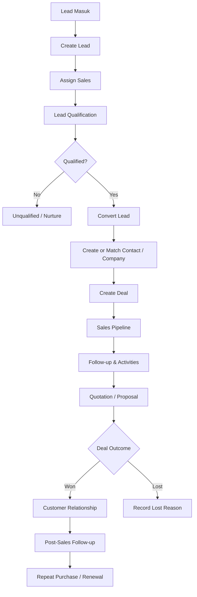
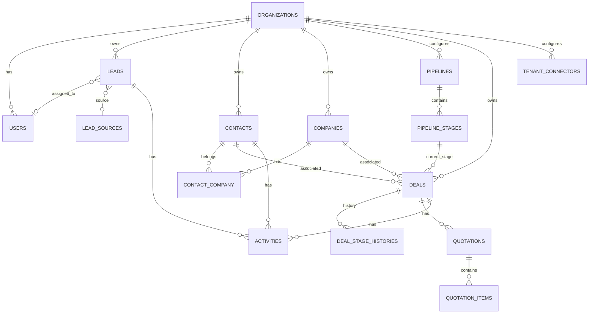
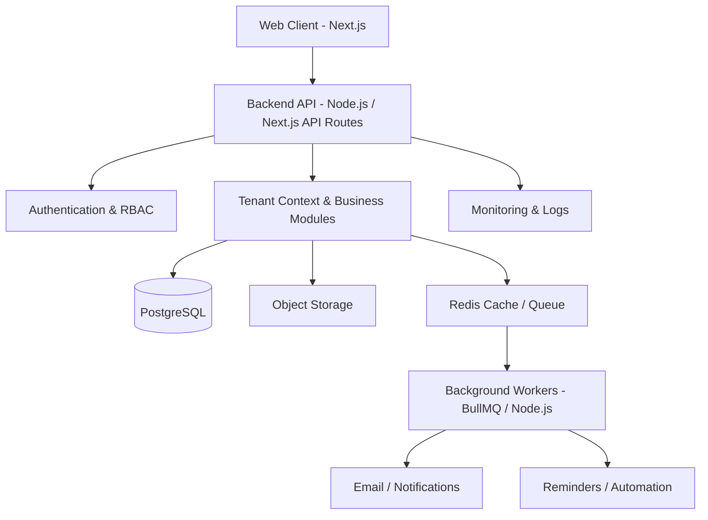

# Product Requirements Document (PRD)

# Cloud-Based General-Purpose CRM

| Informasi         | Detail                                                 |
| ----------------- | ------------------------------------------------------ |
| Nama produk       | TBD                                                    |
| Dokumen           | Product Requirements Document                          |
| Versi             | 1.0                                                    |
| Status            | Draft untuk validasi                                   |
| Platform          | Web Application                                        |
| Model deployment  | Cloud                                                  |
| Target pasar      | General Business                                       |
| Arsitektur produk | Multi-tenant SaaS-ready                                |
| Prioritas produk  | Lead Acquisition, Sales Conversion, Customer Retention |

---

## 1. Ringkasan Produk

Produk ini adalah aplikasi Customer Relationship Management (CRM) berbasis cloud untuk membantu berbagai jenis bisnis mengelola calon pelanggan, proses penjualan, dan hubungan pelanggan dalam satu platform terpusat.

CRM berfokus pada tiga proses bisnis utama:

1. **Lead Acquisition** — menangkap, menyimpan, mengualifikasi, dan mendistribusikan calon pelanggan.
2. **Sales Conversion** — mengelola peluang penjualan, aktivitas sales, penawaran, dan proses closing.
3. **Customer Retention** — menyimpan riwayat pelanggan, mengelola tindak lanjut setelah transaksi, serta mendukung pembelian ulang dan perpanjangan layanan.

Produk harus fleksibel untuk digunakan oleh bisnis jasa, retail, distributor, UMKM, dan perusahaan B2B. Fleksibilitas dicapai melalui configurable sales pipeline, custom fields, tags, dan pengaturan organisasi—bukan dengan membuat fitur khusus untuk setiap industri.

### 1.1 Product Vision

Menjadi platform terpusat yang membantu bisnis memahami pelanggan, mengelola proses penjualan, dan membangun hubungan pelanggan secara konsisten berbasis data.

### 1.2 Value Proposition

- Semua data lead, kontak, perusahaan, dan deal tersimpan secara terpusat.
- Tim mengetahui siapa yang bertanggung jawab atas setiap lead dan deal.
- Aktivitas dan follow-up dapat dijadwalkan serta dipantau.
- Manajemen dapat melihat kondisi pipeline dan performa penjualan.
- Riwayat hubungan pelanggan tetap tersedia setelah transaksi selesai.

### 1.3 Prinsip Produk

- **Easy to use:** input dan pembaruan data harus sederhana.
- **Action-oriented:** sistem menonjolkan tindakan berikutnya, bukan hanya angka.
- **Centralized:** informasi pelanggan memiliki sumber data utama.
- **Configurable:** pipeline dan field dapat disesuaikan oleh organisasi.
- **Secure by default:** data setiap organisasi terisolasi.
- **Incremental:** fitur lanjutan dikembangkan setelah alur inti terbukti berguna.
- **Boilerplate & Library-First:** dilarang membuat ulang fitur komoditas dari nol (_no reinventing the wheel_). Fitur umum (auth, table grid, kanban dnd, form validation, queue, pdf, calendar) wajib memanfaatkan pustaka dan boilerplate open-source standar industri yang sudah teruji.

---

## 2. Target Pengguna dan Persona

| Persona              | Kebutuhan utama                                           |
| -------------------- | --------------------------------------------------------- |
| Business Owner       | Memantau lead, pipeline, closing, dan pendapatan          |
| Administrator        | Mengatur pengguna, tim, data, dan konfigurasi             |
| Sales Manager        | Membagikan lead, memantau aktivitas, dan mengevaluasi tim |
| Sales Representative | Mengelola lead, deal, komunikasi, dan follow-up           |
| Viewer / Management  | Melihat data dan laporan sesuai hak akses                 |

### 2.1 Role dan Hak Akses

| Role                 | Hak akses utama                                           |
| -------------------- | --------------------------------------------------------- |
| Owner                | Akses penuh terhadap organisasi dan seluruh konfigurasi   |
| Admin                | Mengelola pengguna, konfigurasi, dan data sesuai delegasi |
| Sales Manager        | Mengelola tim, assignment, pipeline, dan laporan tim      |
| Sales Representative | Mengelola data yang dimiliki atau diizinkan               |
| Viewer               | Akses baca terhadap data yang diizinkan                   |

Sistem wajib menerapkan **Role-Based Access Control (RBAC)**. Hak akses dapat dibatasi berdasarkan organisasi, tim, kepemilikan record, dan jenis tindakan (view, create, update, delete, export).

---

## 3. Product Scope

### 3.1 In Scope

- Dashboard dan ringkasan aktivitas.
- Lead management.
- Contact dan company management.
- Lead source tracking.
- Lead qualification dan assignment.
- Sales pipeline dan deal management.
- Task, activity, dan follow-up.
- Activity timeline.
- Product/service catalog dasar.
- Quotation management.
- Customer lifecycle dan riwayat transaksi.
- Customer segmentation dasar.
- Reports dan analytics dasar.
- User, team, role, dan permission management.
- Import/export data.
- Custom fields, tags, dan pipeline configuration.
- Notifikasi in-app dan reminder.
- Fondasi integrasi API.
- **Connector Hub:** integrasi mandiri (_self-service_) pihak ketiga untuk AI Model (BYOK: Gemini, OpenAI, Claude), Inbound Webhooks, WhatsApp Gateway, dan Email Delivery.
- **Safe AI Assistant (Human-in-the-Loop):** asistensi cerdas berbasis model BYOK untuk ekstraksi lead, ringkasan catatan meeting, draf pesan follow-up, briefing customer 360, evaluasi risiko deal mangkrak, dan kategorisasi alasan lost.

### 3.2 Out of Scope untuk MVP

Fitur berikut tidak menjadi fokus MVP atau tergolong **AI Red Zone (DILARANG)**:

- **AI Red Zone (Tindakan Otonom Tanpa Manusia):**
  - AI auto-send pesan/email langsung ke klien tanpa review sales rep.
  - AI kalkulasi matematika harga, diskon, atau pajak (wajib menggunakan kode deterministik).
  - AI auto-move pipeline stages atau auto-closing deals tanpa bukti user.
  - AI auto-delete atau auto-merge data kontak/perusahaan (AI hanya mendeteksi potensi duplikat).
- Full accounting dan general ledger.
- Inventory dan warehouse management.
- Payroll dan human resource management.
- POS dan full ERP.
- Full marketing automation dan campaign orchestration multi-channel.
- Project management kompleks.
- Advanced predictive sales forecasting.
- Omnichannel shared inbox.
- Payment gateway dan subscription billing kompleks.

Fitur out of scope dapat dipertimbangkan setelah kebutuhan pengguna dan kelayakan bisnis divalidasi.

---

## 4. Struktur Modul dan Functional Requirements

Prioritas:

- **P0:** wajib untuk MVP.
- **P1:** penting, dapat masuk setelah alur inti stabil.
- **P2:** pengembangan lanjutan.

### 4.1 Dashboard

**Tujuan:** memberikan gambaran kondisi penjualan dan daftar tindakan yang perlu dilakukan.

| ID      | Requirement                                                  | Prioritas |
| ------- | ------------------------------------------------------------ | --------- |
| DASH-01 | Menampilkan total lead, deal aktif, customer, dan nilai deal | P0        |
| DASH-02 | Menampilkan lead baru berdasarkan periode                    | P0        |
| DASH-03 | Menampilkan ringkasan sales pipeline                         | P0        |
| DASH-04 | Menampilkan aktivitas mendatang                              | P0        |
| DASH-05 | Menampilkan aktivitas terlambat                              | P0        |
| DASH-06 | Menampilkan aktivitas terbaru                                | P1        |
| DASH-07 | Menampilkan performa sales                                   | P1        |
| DASH-08 | Menampilkan performa lead source                             | P1        |
| DASH-09 | Mendukung filter periode, tim, dan pengguna                  | P1        |
| DASH-10 | Menampilkan panel Action Required                            | P0        |

Panel **Action Required** sekurangnya menampilkan:

- Lead baru yang belum ditindaklanjuti.
- Follow-up yang terlambat.
- Deal aktif tanpa next activity.
- Quotation yang perlu ditindaklanjuti.

### 4.2 Lead Management

**Tujuan:** mengelola calon pelanggan sejak pertama kali masuk hingga dikualifikasi atau dikonversi.

| ID      | Requirement                                                | Prioritas |
| ------- | ---------------------------------------------------------- | --------- |
| LEAD-01 | Membuat, melihat, mengubah, dan mengarsipkan lead          | P0        |
| LEAD-02 | Menyimpan nama, kontak, perusahaan, kebutuhan, dan catatan | P0        |
| LEAD-03 | Mencatat sumber lead                                       | P0        |
| LEAD-04 | Mengatur status lead                                       | P0        |
| LEAD-05 | Menetapkan owner atau sales yang bertanggung jawab         | P0        |
| LEAD-06 | Mencatat kebutuhan, budget, dan urgency                    | P0        |
| LEAD-07 | Menambahkan tags dan custom fields                         | P1        |
| LEAD-08 | Mendeteksi potensi data duplikat                           | P1        |
| LEAD-09 | Mengonversi lead menjadi contact, company, dan deal        | P0        |
| LEAD-10 | Mengimpor dan mengekspor lead                              | P0        |
| LEAD-11 | Mencari, memfilter, dan mengurutkan lead                   | P0        |
| LEAD-12 | Mencatat catatan dan aktivitas terkait lead                | P0        |
| LEAD-13 | Mendukung lead capture melalui API/form website            | P1        |

Status lead default:

- New
- Contacted
- Qualified
- Unqualified

Status harus dapat dikonfigurasi secara terbatas oleh administrator. Status lead tidak boleh disamakan dengan tahapan deal.

### 4.3 Contact & Company Management

**Tujuan:** menyediakan sumber data utama untuk individu dan organisasi yang berhubungan dengan bisnis.

| ID      | Requirement                                           | Prioritas |
| ------- | ----------------------------------------------------- | --------- |
| CONT-01 | CRUD contact                                          | P0        |
| CONT-02 | CRUD company                                          | P0        |
| CONT-03 | Menghubungkan contact dengan company                  | P0        |
| CONT-04 | Mendukung beberapa contact dalam satu company         | P0        |
| CONT-05 | Menyimpan email, telepon, alamat, dan informasi dasar | P0        |
| CONT-06 | Menyimpan tags dan kategori customer                  | P1        |
| CONT-07 | Mendukung custom fields                               | P1        |
| CONT-08 | Menampilkan related deals                             | P0        |
| CONT-09 | Menampilkan activity timeline                         | P0        |
| CONT-10 | Menyimpan catatan internal                            | P0        |
| CONT-11 | Import/export contact dan company                     | P1        |
| CONT-12 | Mencari dan memfilter record                          | P0        |

Satu contact dapat memiliki relasi dengan satu atau lebih company bila kebutuhan bisnis mengharuskannya. Relasi tersebut harus dimodelkan secara eksplisit, bukan hanya menyimpan nama perusahaan sebagai teks.

### 4.4 Sales Pipeline & Deal Management

**Tujuan:** mengelola peluang penjualan hingga berhasil atau gagal.

| ID      | Requirement                                        | Prioritas |
| ------- | -------------------------------------------------- | --------- |
| DEAL-01 | Membuat dan mengelola deal                         | P0        |
| DEAL-02 | Menghubungkan deal dengan contact dan/atau company | P0        |
| DEAL-03 | Menetapkan deal owner                              | P0        |
| DEAL-04 | Menyimpan nilai deal dan mata uang                 | P0        |
| DEAL-05 | Menyimpan expected closing date                    | P0        |
| DEAL-06 | Mengelola pipeline dan stages                      | P0        |
| DEAL-07 | Menampilkan pipeline dalam Kanban                  | P0        |
| DEAL-08 | Mendukung lebih dari satu pipeline                 | P1        |
| DEAL-09 | Mengatur probability per stage atau deal           | P1        |
| DEAL-10 | Menandai deal Won atau Lost                        | P0        |
| DEAL-11 | Mencatat alasan Lost                               | P0        |
| DEAL-12 | Menyimpan riwayat perubahan stage                  | P1        |
| DEAL-13 | Menghubungkan produk/layanan dengan deal           | P1        |
| DEAL-14 | Menampilkan nilai pipeline dan ringkasan stage     | P0        |

Default stages:

1. New Opportunity
2. Contacted
3. Needs Analysis
4. Proposal / Quotation
5. Negotiation
6. Won
7. Lost

Won dan Lost merupakan outcome terminal, bukan stage aktif biasa. Organisasi dapat menyesuaikan stage pipeline.

### 4.5 Activity & Task Management

**Tujuan:** memastikan setiap aktivitas pelanggan dan tindak lanjut tercatat.

| ID     | Requirement                                                      | Prioritas |
| ------ | ---------------------------------------------------------------- | --------- |
| ACT-01 | Membuat dan mengelola task                                       | P0        |
| ACT-02 | Menentukan assignee dan due date                                 | P0        |
| ACT-03 | Menghubungkan aktivitas dengan lead, contact, company, atau deal | P0        |
| ACT-04 | Mencatat call, meeting, email, dan notes                         | P0        |
| ACT-05 | Menjadwalkan follow-up                                           | P0        |
| ACT-06 | Menandai task selesai atau dibatalkan                            | P0        |
| ACT-07 | Menampilkan kalender aktivitas                                   | P1        |
| ACT-08 | Menampilkan upcoming dan overdue activities                      | P0        |
| ACT-09 | Mengirim in-app reminder                                         | P0        |
| ACT-10 | Menampilkan activity timeline                                    | P0        |
| ACT-11 | Menyediakan template aktivitas                                   | P2        |

Setiap deal aktif sebaiknya memiliki **next activity**. Sistem dapat memberikan peringatan jika deal tidak memiliki aktivitas berikutnya, tetapi tidak boleh menghalangi pengguna menyimpan deal.

### 4.6 Product & Service Catalog

**Tujuan:** menyediakan daftar item yang dapat digunakan dalam quotation dan deal.

| ID      | Requirement                                           | Prioritas |
| ------- | ----------------------------------------------------- | --------- |
| PROD-01 | CRUD produk dan layanan                               | P1        |
| PROD-02 | Menyimpan nama, deskripsi, SKU opsional, dan kategori | P1        |
| PROD-03 | Menyimpan harga dan mata uang                         | P1        |
| PROD-04 | Mengaktifkan atau menonaktifkan item                  | P1        |
| PROD-05 | Menghubungkan item dengan quotation                   | P1        |

Modul ini bukan inventory management. Stok, gudang, dan mutasi barang tidak termasuk cakupan.

### 4.7 Quotation Management

**Tujuan:** membuat dan mengelola penawaran harga yang berhubungan dengan deal.

| ID     | Requirement                                      | Prioritas |
| ------ | ------------------------------------------------ | --------- |
| QUO-01 | Membuat quotation                                | P1        |
| QUO-02 | Menambahkan item dan quantity                    | P1        |
| QUO-03 | Menghitung subtotal, diskon, pajak, dan total    | P1        |
| QUO-04 | Mengatur masa berlaku quotation                  | P1        |
| QUO-05 | Menghasilkan PDF                                 | P1        |
| QUO-06 | Menghubungkan quotation dengan deal dan customer | P1        |
| QUO-07 | Mengelola status quotation                       | P1        |
| QUO-08 | Menyimpan versi dan riwayat perubahan            | P2        |

Status quotation:

- Draft
- Sent
- Accepted
- Rejected
- Expired

Perhitungan pajak harus menggunakan konfigurasi yang jelas. CRM tidak boleh mengklaim sebagai sistem perpajakan atau akuntansi.

### 4.8 Customer Retention

**Tujuan:** mendukung hubungan pelanggan setelah deal berhasil.

| ID     | Requirement                                       | Prioritas |
| ------ | ------------------------------------------------- | --------- |
| RET-01 | Mengidentifikasi customer dari deal Won           | P0        |
| RET-02 | Menampilkan riwayat deal dan pembelian            | P0        |
| RET-03 | Menampilkan seluruh aktivitas customer            | P0        |
| RET-04 | Mengelompokkan customer menggunakan tags/segments | P1        |
| RET-05 | Menjadwalkan post-sales follow-up                 | P1        |
| RET-06 | Mencatat feedback dan complaint                   | P1        |
| RET-07 | Menjadwalkan renewal reminder                     | P1        |
| RET-08 | Mengidentifikasi peluang repeat purchase          | P2        |

Customer tidak perlu dibuat ulang secara manual ketika deal berubah menjadi Won. Status hubungan pelanggan harus berasal dari data transaksi yang terkait.

### 4.9 Reports & Analytics

**Tujuan:** membantu owner dan sales manager mengevaluasi kinerja.

| ID     | Requirement                         | Prioritas |
| ------ | ----------------------------------- | --------- |
| REP-01 | Lead report                         | P0        |
| REP-02 | Sales pipeline report               | P0        |
| REP-03 | Won/Lost report                     | P0        |
| REP-04 | Conversion report                   | P1        |
| REP-05 | Lead source report                  | P1        |
| REP-06 | Sales performance report            | P1        |
| REP-07 | Activity dan follow-up report       | P1        |
| REP-08 | Revenue report berdasarkan deal Won | P1        |
| REP-09 | Filter periode, user, dan team      | P1        |
| REP-10 | Export report                       | P1        |

Definisi metrik harus konsisten. Contohnya, conversion rate harus menyebutkan cohort, periode, dan denominator yang digunakan. Nilai deal Won bukan otomatis sama dengan cash received atau accounting revenue.

### 4.10 Settings & Administration

| ID     | Requirement                    | Prioritas |
| ------ | ------------------------------ | --------- |
| SET-01 | Organization profile           | P0        |
| SET-02 | User invitation dan management | P0        |
| SET-03 | Role dan permission            | P0        |
| SET-04 | Team management                | P1        |
| SET-05 | Pipeline configuration         | P0        |
| SET-06 | Lead source configuration      | P0        |
| SET-07 | Tags management                | P1        |
| SET-08 | Custom fields                  | P1        |
| SET-09 | Notification preferences       | P1        |
| SET-10 | Audit log                      | P0        |
| SET-11 | Import/export settings         | P1        |
| SET-12 | Integration settings           | P2        |

### 4.11 Connector Hub & Safe AI Assistant

**Tujuan:** menyediakan katalog integrasi mandiri (_self-service_) pihak ketiga dan kemampuan asistensi kecerdasan buatan (_Safe AI Assistant_) berbasis **BYOK (Bring Your Own Key)** yang aman, terukur, dan bebas biaya token bagi penyedia platform.

#### 4.11.1 Connector Hub Requirements

| ID      | Requirement                                                               | Prioritas |
| ------- | ------------------------------------------------------------------------- | --------- |
| CONN-01 | Antarmuka katalog Connector Hub berbasis Card Grid di Settings            | P0        |
| CONN-02 | Manajemen API Key mandiri (BYOK) dengan enkripsi AES-256-GCM              | P0        |
| CONN-03 | Tombol "Test Connection" untuk memverifikasi validitas kunci/token        | P0        |
| CONN-04 | Dukungan multi-provider AI (Google Gemini, OpenAI, Anthropic, OpenRouter) | P1        |
| CONN-05 | Inbound Webhook Generator untuk menangkap lead dari form website          | P1        |
| CONN-06 | WhatsApp Gateway & Email Delivery Connector (Resend / SMTP)               | P1        |

#### 4.11.2 Safe AI Assistant Requirements (Human-in-the-Loop)

| ID    | Requirement                                                                                                                                                 | Prioritas |
| ----- | ----------------------------------------------------------------------------------------------------------------------------------------------------------- | --------- |
| AI-01 | **Text-to-Lead Extractor:** mengekstrak teks pesan bebas (WA/Email) menjadi draf field lead terstruktur (nama, perusahaan, kebutuhan, budget, urgensi)      | P1        |
| AI-02 | **Meeting & Call Summarizer:** mengubah coretan catatan kasar sales menjadi ringkasan interaksi terstruktur 2 paragraf                                      | P1        |
| AI-03 | **Action Item Extractor:** mendeteksi komitmen tanggal dari catatan interaksi dan membuat draf jadwal _next activity_                                       | P1        |
| AI-04 | **Smart Follow-up Ghostwriter:** menghasilkan 3 opsi draf pesan follow-up (WA/Email) kontekstual berdasarkan riwayat interaksi terakhir                     | P1        |
| AI-05 | **Customer 360 Executive Briefing:** menghasilkan cheat-sheet 3 butir (total belanja, isu terakhir, peluang repeat/renewal) sebelum sales menghubungi klien | P1        |
| AI-06 | **Deal Risk Advisor:** menampilkan badge peringatan pasif pada kartu Kanban jika deal mandek tanpa interaksi mendekati target closing date                  | P1        |
| AI-07 | **Lost Reason Categorizer:** mengklasifikasikan teks bebas alasan penolakan klien menjadi kategori baku untuk laporan analitik                              | P1        |
| AI-08 | **Quotation Narrative Drafter:** menyusun draf pengantar ruang lingkup pekerjaan (_Scope of Work_) pada surat penawaran                                     | P2        |

#### 4.11.3 Aturan Batasan Keamanan AI (Red Zone Policy)

Sistem wajib menerapkan **Guardrails Ketat**:

1. **Dilarang Auto-Send:** AI dilarang mengirim email, pesan WhatsApp, atau dokumen langsung ke pihak eksternal tanpa persetujuan eksplisit pengguna.
2. **Dilarang Auto-Calculate Angka Finansial:** kalkulasi subtotal, diskon, PPN, dan total quotation wajib dieksekusi oleh fungsi matematika deterministik, bukan prediksi LLM.
3. **Dilarang Auto-Mutate Status:** AI dilarang memindahkan stage deal atau menandai deal Won/Lost secara otonom.
4. **Dilarang Auto-Merge / Auto-Delete:** AI hanya diperbolehkan memberi label indikasi duplikat; eksekusi penggabungan data tetap di tangan pengguna.
5. **Enkripsi Kunci & Isolasi Tenant:** API Key disimpan terenkripsi di server, dimasking di antarmuka pengguna (`sk-...xxxx`), dan diisolasi ketat per `organization_id`.

---

## 5. Navigation & Information Architecture

Struktur navigasi yang direkomendasikan:

```text
Workspace
├── Dashboard
├── Leads
├── Contacts
├── Companies
├── Deals & Pipelines
│   ├── Pipeline Board
│   └── Deal List
│
Productivity
├── Activities & Tasks
├── Calendar
└── Quotations

Customers & Insights
├── Customers
├── Reports & Analytics
└── Customer Feedback

Administration
├── Users & Teams
├── Automation
└── Settings
    ├── Organization
    ├── Roles & Permissions
    ├── Pipelines
    ├── Lead Sources
    ├── Custom Fields
    ├── Tags
    └── Connectors & Integrations
        ├── AI Models (BYOK: Gemini, OpenAI, Claude)
        ├── Inbound Webhooks (Lead Forms)
        ├── WhatsApp Gateway
        └── Email Delivery (Resend / SMTP)
```

Global UI requirements & Boilerplate Design System:

- **Base Components:** 100% menggunakan katalog komponen **shadcn/ui** (Button, Dialog, DropdownMenu, Tabs, Sheet, Badge, Avatar, Separator) berbasis Radix UI Primitives yang accessible (WAI-ARIA). Dilarang menulis komponen HTML/CSS mentah dari awal.
- **Aesthetic & Density:** Standar desain SaaS modern berdensitas data tinggi (_high information density_ ala Linear/Attio/Stripe), dengan tipografi rapi, jarak padat (_compact spacing_), dan hierarki visual yang jelas.
- **Theming:** Mendukung **Dark Mode** dan **Light Mode** bawaan secara otomatis menggunakan token CSS variables semantik dan pustaka `next-themes`.
- **Slide-over Drawers (Sheet):** Aksi cepat seperti _Quick Add Lead_, _Quick Add Task_, dan _Preview Detail_ menggunakan komponen Drawer/Sheet samping kanan, sehingga pengguna tidak perlu berpindah halaman (_context preserved_).
- **Global Search:** Command Palette (Ctrl+K / Cmd+K) menggunakan `cmdk` untuk pencarian cepat lintas lead, contact, company, dan deal.
- **Data Display:** Data Table menggunakan `@tanstack/react-table` dengan filter, sorting, pagination, dan saved views.
- **Pipeline Kanban:** Drag-and-drop antar kolom status deal menggunakan `@hello-pangea/dnd`.
- **Activity Timeline:** Tampilan feed kronologis terpadu pada halaman detail record dengan quick composer untuk log telepon/catatan/meeting.
- **Empty States:** State kosong di setiap tabel memuat instruksi yang mengarahkan tindakan selanjutnya (misal: "Belum ada lead aktif. [Import CSV] atau [+ Tambah Lead]").
- **Responsive Layout:** Sidebar yang dapat dilipat (_collapsible sidebar_), adaptif untuk desktop, tablet, dan smartphone.

---

## 6. Core User Flows

### 6.1 Lead-to-Customer Flow



### 6.2 Lead Management Flow

1. Pengguna membuka Lead List.
2. Pengguna membuat lead atau menerima lead dari sumber terintegrasi.
3. Sistem memvalidasi field wajib dan memeriksa potensi duplikasi.
4. Lead ditetapkan kepada sales.
5. Sales menghubungi dan mengualifikasi lead.
6. Sales mencatat aktivitas dan next follow-up.
7. Jika qualified, lead dikonversi menjadi contact/company dan deal.
8. Jika tidak qualified, alasan dan status dicatat.

### 6.3 Sales Follow-up Flow

1. Sales membuka dashboard atau daftar aktivitas.
2. Sales memilih task yang akan dikerjakan.
3. CRM menampilkan detail lead/customer dan riwayat interaksi.
4. Sales melakukan komunikasi melalui kanal yang tersedia.
5. Sales mencatat hasil komunikasi.
6. Sales menyelesaikan task atau membuat follow-up berikutnya.
7. Perubahan tersimpan dalam activity timeline.

### 6.4 Deal Flow

1. Deal dibuat dari lead yang dikonversi atau langsung dari contact/company.
2. Deal diberi owner, nilai, pipeline, stage, dan estimasi closing.
3. Sales memperbarui stage berdasarkan progres.
4. Sales membuat aktivitas dan quotation jika diperlukan.
5. Deal ditandai Won atau Lost.
6. Jika Won, data customer dan riwayat transaksi diperbarui.
7. Jika Lost, alasan kegagalan dicatat untuk analisis.

### 6.5 Customer Retention Flow

1. Deal Won memperbarui status hubungan customer.
2. CRM menyimpan transaksi pada customer history.
3. Sales membuat post-sales follow-up.
4. Interaksi dan feedback dicatat.
5. Jika ada kebutuhan baru, sales membuat deal baru.
6. Jika ada kontrak atau layanan berulang, renewal reminder dapat dijadwalkan.

---

## 7. Data Model & Database Requirements

Database menggunakan relational database PostgreSQL. Model data harus mendukung multi-tenancy, auditability, dan konsistensi relasi.

> **Catatan environment:** PostgreSQL development dijalankan via **Docker Compose** milik project ini (`docker-compose.yml`, image `postgres:16-alpine`, container `crm-postgres`, data di volume `crm_pgdata`). Host port **5434** (`localhost:5434`) agar tidak bentrok dengan Postgres lain di mesin. Koneksi lewat `DATABASE_URL` di `.env` (lihat `.env.example`). Jalankan dengan `docker compose up -d`.

### 7.1 Core Entities

| Entity                   | Fungsi                                                                                |
| ------------------------ | ------------------------------------------------------------------------------------- |
| organizations            | Tenant / perusahaan pengguna CRM                                                      |
| users                    | Akun pengguna                                                                         |
| roles                    | Role pengguna                                                                         |
| permissions              | Hak akses                                                                             |
| organization_users       | Relasi user dan organisasi                                                            |
| teams                    | Tim dalam organisasi                                                                  |
| team_members             | Anggota tim                                                                           |
| leads                    | Calon pelanggan                                                                       |
| lead_sources             | Sumber lead                                                                           |
| contacts                 | Individu                                                                              |
| companies                | Perusahaan pelanggan/prospek                                                          |
| contact_company          | Relasi contact dan company                                                            |
| pipelines                | Pipeline penjualan                                                                    |
| pipeline_stages          | Tahapan pipeline                                                                      |
| deals                    | Peluang transaksi                                                                     |
| deal_stage_histories     | Riwayat perubahan stage                                                               |
| activities               | Task, call, meeting, email log, notes                                                 |
| products                 | Produk dan layanan                                                                    |
| quotations               | Dokumen penawaran                                                                     |
| quotation_items          | Item quotation                                                                        |
| customer_segments        | Segmentasi pelanggan                                                                  |
| tags                     | Label data                                                                            |
| taggables                | Relasi tags polymorphic                                                               |
| custom_field_definitions | Definisi custom fields                                                                |
| custom_field_values      | Nilai custom fields                                                                   |
| notifications            | Notifikasi pengguna                                                                   |
| audit_logs               | Riwayat perubahan penting                                                             |
| files                    | Metadata dokumen/attachment                                                           |
| tenant_connectors        | Konfigurasi integrasi & API Key (BYOK AI, Webhook, WA, Email) terenkripsi AES-256-GCM |

### 7.2 Important Data Relationships



Diagram di atas merupakan gambaran konseptual. Implementasi perlu menetapkan foreign key, aturan delete, dan relasi polymorphic secara eksplisit.

### 7.3 Multi-Tenancy Requirements

- Setiap business record harus memiliki `organization_id`.
- Data antarorganisasi harus terisolasi.
- Tenant context ditentukan dari identitas dan membership pengguna yang terautentikasi.
- Backend wajib menerapkan tenant scope pada setiap query.
- Jangan mempercayai `organization_id` yang dikirim bebas oleh client.
- Unique constraint perlu mempertimbangkan tenant, misalnya email contact dalam satu organisasi jika kebijakan bisnis mengharuskannya.
- File storage harus dipisahkan berdasarkan tenant.
- Automated tests wajib menguji akses silang antar-tenant.

### 7.4 General Data Conventions

Field umum yang direkomendasikan:

- `id` — UUID.
- `organization_id` — tenant identifier.
- `created_at`.
- `updated_at`.
- `created_by`.
- `updated_by`.
- `deleted_at` untuk soft delete jika diperlukan.

Gunakan decimal/numeric untuk nilai uang, bukan floating point. Simpan kode mata uang (misalnya ISO 4217) bersama nilai uang. Simpan timestamp dalam UTC dan tampilkan menurut timezone organisasi/pengguna.

---

## 8. Integrations & Automation

### 8.1 MVP Integrations & Connectors

| Integrasi / Connector | Scope & Implementasi                                                 |
| --------------------- | -------------------------------------------------------------------- |
| **AI Models (BYOK)**  | Google Gemini, OpenAI, Claude via Vercel AI SDK dengan kunci mandiri |
| **Inbound Webhook**   | Endpoint unik per tenant untuk menangkap lead dari form website      |
| **WhatsApp**          | Shortcut click-to-chat (wa.me) & integrasi gateway pihak ketiga      |
| **Email Delivery**    | Transaksional email via Resend SDK atau SMTP kustom                  |
| **CSV / XLSX**        | Import dan export data massal via PapaParse & ExcelJS                |
| **Object Storage**    | Penyimpanan dokumen dan PDF via S3-compatible storage                |

### 8.2 Later Integrations

- WhatsApp Business Platform API.
- Shared inbox dan conversation assignment.
- Email provider synchronization.
- Calendar provider synchronization.
- Accounting, ERP, dan POS melalui API.
- Webhooks untuk event bisnis.

### 8.3 Basic Automation

Automation MVP sebaiknya berbasis event dan rule sederhana, misalnya:

- Saat lead dibuat, assign berdasarkan aturan tertentu.
- Saat task mendekati due date, kirim reminder.
- Saat deal berubah menjadi Won, perbarui customer lifecycle.
- Saat quotation mendekati expiry, buat follow-up task.

Automation harus memiliki log eksekusi, batas permission, dan mekanisme mencegah eksekusi berulang yang tidak disengaja.

---

## 9. Non-Functional Requirements

| Area           | Requirement                                    |
| -------------- | ---------------------------------------------- |
| Architecture   | Modular monolith                               |
| Deployment     | Cloud-hosted web application                   |
| Database       | PostgreSQL                                     |
| Security       | Secure authentication, RBAC, tenant isolation  |
| API            | REST API dengan validasi dan versioning        |
| Performance    | Pagination, indexing, query optimization       |
| Availability   | Monitoring dan backup terjadwal                |
| Data Integrity | Foreign keys, constraints, transactions        |
| Auditability   | Audit trail untuk perubahan penting            |
| Responsive     | Desktop, tablet, dan mobile                    |
| Localization   | Timezone, currency, date format                |
| Privacy        | Data access control dan perlindungan data      |
| Reliability    | Error handling dan retry untuk background jobs |

### 9.1 Security Requirements

- Password disimpan menggunakan password hashing yang kuat.
- Session dan token dikelola secara aman.
- Rate limiting pada endpoint sensitif.
- Validasi input di server.
- Proteksi terhadap IDOR dan akses lintas tenant.
- Permission diperiksa pada backend.
- Audit log untuk perubahan sensitif.
- Secret dan API key tidak disimpan di source code.
- Backup dienkripsi dan aksesnya dibatasi.
- Prosedur restore diuji secara berkala.

### 9.2 Performance & Reliability

Target awal yang dapat digunakan untuk pengujian:

- P95 response time endpoint umum di bawah 500 ms pada beban uji yang disepakati, tidak termasuk operasi berat.
- Pagination wajib untuk daftar data.
- Operasi import, export besar, dan PDF dapat dijalankan sebagai background jobs.
- Error aplikasi tercatat dan dapat ditelusuri.
- Backup dan restore memiliki prosedur terdokumentasi.

Angka performa merupakan target awal, bukan jaminan sebelum load testing.

---

## 10. Technical Architecture

Rekomendasi arsitektur: **Modular Monolith** berbasis TypeScript penuh (Full-stack TypeScript: Next.js + Node.js). Hindari microservices pada MVP karena kompleksitas deployment dan operasional belum sebanding dengan kebutuhan awal.



### 10.1 Recommended Stack

| Layer          | Technology                                                       |
| -------------- | ---------------------------------------------------------------- |
| Frontend       | Next.js (App Router) + React + TypeScript                        |
| UI             | Tailwind CSS + shadcn/ui                                         |
| Backend        | Node.js (Next.js Route Handlers / NestJS / Express) + TypeScript |
| Database       | PostgreSQL                                                       |
| ORM            | Prisma / Drizzle ORM                                             |
| Validation     | Zod (Shared validation schema antara Frontend & Backend)         |
| Authentication | NextAuth.js (Auth.js) / Better Auth / JWT Session dengan RBAC    |
| Authorization  | RBAC Middleware & Tenant Scope Guards                            |
| Cache & Queue  | Redis + BullMQ                                                   |
| File Storage   | S3-compatible object storage (@aws-sdk/client-s3)                |
| Charts         | Recharts                                                         |
| PDF            | @react-pdf/renderer atau Puppeteer                               |
| AI Integration | Vercel AI SDK (ai, @ai-sdk/google, @ai-sdk/openai)               |
| Deployment     | Docker + Cloud VPS / managed cloud                               |
| Monitoring     | Application logs (Pino/Winston) dan error tracking               |

Penggunaan full-stack TypeScript (Node.js dan Next.js) memberikan keuntungan efisiensi signifikan bagi tim: **End-to-End Type Safety**, berbagi skema validasi (Zod) langsung antara client dan server, serta ekosistem komponen UI modern yang terintegrasi secara mulus.

### 10.2 Boilerplate & Library-First Strategy (No Reinventing the Wheel)

Prinsip mutlak: **Jangan pernah membuat dari nol fitur komoditas yang sudah diselesaikan secara matang oleh open-source ecosystem.** Tim pengembang dilarang membuang waktu membuat custom table pagination, drag-and-drop handler manual, atau auth engine sendiri.

Berikut adalah pemetaan wajib pustaka dan boilerplate untuk setiap modul:

| Kategori Fitur                | Kebutuhan Modul                                                       | Pustaka / Boilerplate Standar                                   | Alasan Pemilihan & Keunggulan                                                                                                         |
| ----------------------------- | --------------------------------------------------------------------- | --------------------------------------------------------------- | ------------------------------------------------------------------------------------------------------------------------------------- |
| **Auth & Organizations**      | Login, multi-tenant workspace, user invitation, session               | **Better Auth** (dengan Organization plugin) atau **Auth.js**   | Fitur multi-organization, token invitation, session cookie HTTP-only, password hash aman langsung tersedia out-of-the-box.            |
| **RBAC / Authorization**      | Izin aksi (view, create, edit, delete, export) per role               | **CASL (`@casl/ability`)** atau Better Auth RBAC                | Standar industri untuk deklarasi hak akses isomorfik (dapat dievaluasi di frontend UI dan backend API).                               |
| **Data Tables / Grids**       | Lead list, Contact, Deal, Activity, Customer table                    | **TanStack Table v8 (`@tanstack/react-table`)** + **shadcn/ui** | Menyediakan sorting, server-side/client-side pagination, multi-column filtering, dan column visibility tanpa membuat UI table manual. |
| **Kanban Board**              | Visualisasi Deal Pipeline & drag-and-drop antar stage                 | **@hello-pangea/dnd** (atau **@dnd-kit**)                       | Pustaka drag-and-drop standar industri untuk React 18/19, mendukung keyboard accessibility dan transisi animasi mulus.                |
| **Form & Validasi**           | Form lead, deal, quotation, settings                                  | **React Hook Form** + **Zod** (`@hookform/resolvers/zod`)       | Validasi data tanpa re-render berlebih, pesan error otomatis, dan skema Zod dapat di-reuse langsung di API handler.                   |
| **Global Search**             | Command Palette / Quick Search (Ctrl+K / Cmd+K)                       | **cmdk** (basis komponen Command shadcn/ui)                     | Pencarian instan melintasi lead, kontak, dan deal dengan navigasi keyboard.                                                           |
| **Activity Calendar**         | Tampilan kalender aktivitas harian/mingguan sales                     | **@fullcalendar/react** atau **react-day-picker**               | Grid kalender interaktif bawaan untuk melihat jadwal pertemuan, follow-up, dan call.                                                  |
| **CSV Import & Export**       | Bulk upload data kontak dan ekspor laporan                            | **PapaParse** (CSV) + **ExcelJS** (XLSX)                        | Streaming parser performan tinggi di browser dan server, mencegah memory leak saat import ribuan baris.                               |
| **PDF Generation**            | Dokumen penawaran resmi (Quotation)                                   | **@react-pdf/renderer**                                         | Menghasilkan file PDF langsung dari deklarasi komponen React tanpa memerlukan headless browser (Chromium) yang berat.                 |
| **Dashboard Analytics**       | Grafik performa pipeline, lead source, revenue                        | **shadcn/ui Charts** (berbasis **Recharts**)                    | Komponen visualisasi data siap pakai yang serasi dengan tema Tailwind CSS.                                                            |
| **Job Queue & Scheduling**    | Background worker, reminder follow-up, bulk jobs                      | **BullMQ** + **ioredis**                                        | Sistem antrean berbasis Redis paling teruji di Node.js, mendukung delay job, auto-retry exponential backoff, dan cron scheduling.     |
| **In-App Toast & Alerts**     | Feedback aksi pengguna (sukses/gagal/peringatan)                      | **Sonner** (komponen Toast default shadcn/ui)                   | Toast ringan, elegan, mendukung promise-based notification.                                                                           |
| **Rich Text Editor**          | Catatan meeting, detail interaksi lead, catatan deal                  | **Tiptap (`@tiptap/react`)**                                    | Headless rich text editor modern, modular, dan mudah dikombinasikan dengan Tailwind.                                                  |
| **Date & Time Calculations**  | Perhitungan overdue task, relative time, timezone                     | **date-fns**                                                    | Library tanggal fungsional dan modular, menghemat bundle size dibanding Moment.js.                                                    |
| **Iconography**               | Seluruh icon navigasi dan status                                      | **Lucide Icons (`lucide-react`)**                               | Icon set resmi ekosistem shadcn/ui dengan ratusan icon konsisten.                                                                     |
| **Database ORM & Migrations** | Type-safe database queries dan migrasi PostgreSQL                     | **Prisma** atau **Drizzle ORM**                                 | Schema migration otomatis, TypeScript type inference otomatis, pencegahan SQL Injection.                                              |
| **AI Integration & BYOK**     | Safe AI Assist (Lead parsing, note summarizer, follow-up ghostwriter) | **Vercel AI SDK (`ai` + `@ai-sdk/google` + `@ai-sdk/openai`)**  | Standard industri Next.js, streaming response, Zod structured output, dan inisialisasi dinamis kunci API per tenant.                  |

---

## 11. Development Roadmap & Backlog

Estimasi awal: 8 sprint, masing-masing 2 minggu, sekitar 16 minggu untuk satu developer full-stack yang berpengalaman. Estimasi perlu disesuaikan setelah technical discovery dan validasi desain.

### Sprint 1 — Foundation & Authentication

**Priority: P0**

- [ ] Project setup dan repository structure.
- [ ] Environment dan deployment development.
- [ ] Database setup dan migration foundation.
- [ ] Authentication: login, logout, password reset.
- [ ] Organization/workspace management.
- [ ] Organization membership.
- [ ] User management.
- [ ] RBAC foundation.
- [ ] Tenant isolation middleware/scope.
- [ ] Audit log foundation.
- [ ] Connector Hub foundation & AES-256-GCM encryption util.
- [ ] BYOK AI Provider Settings (Gemini / OpenAI API Key) & Test Connection.

**Deliverable:** aplikasi dasar dengan workspace dan isolasi data organisasi.

### Sprint 2 — Lead & Contact Management

**Priority: P0**

- [ ] Lead CRUD.
- [ ] Contact CRUD.
- [ ] Company CRUD.
- [ ] Contact-company relationship.
- [ ] Lead source configuration.
- [ ] Lead status management.
- [ ] Lead assignment.
- [ ] Lead qualification.
- [ ] Lead conversion.
- [ ] Duplicate detection dasar.
- [ ] CSV import/export.
- [ ] Inbound lead capture via Webhook.
- [ ] Safe AI: Text-to-Lead extractor (unstructured text parser).
- [ ] Search, filter, sorting, pagination.

**Deliverable:** pengguna dapat mengelola lead, contact, dan company.

### Sprint 3 — Sales Pipeline & Deal

**Priority: P0**

- [ ] Pipeline configuration.
- [ ] Pipeline stages.
- [ ] Kanban board.
- [ ] Deal CRUD.
- [ ] Deal assignment.
- [ ] Deal value dan currency.
- [ ] Expected closing date.
- [ ] Deal probability dasar.
- [ ] Won/Lost management.
- [ ] Lost reason.
- [ ] Safe AI: Deal risk advisor badge pada kartu Kanban.
- [ ] Deal stage history.

**Deliverable:** tim sales dapat mengelola peluang penjualan.

### Sprint 4 — Activity & Follow-up

**Priority: P0**

- [ ] Activity CRUD.
- [ ] Task management.
- [ ] Task assignment.
- [ ] Follow-up scheduling.
- [ ] Call, meeting, email, dan notes log.
- [ ] Safe AI: Meeting & call notes summarizer.
- [ ] Safe AI: Action item & next task suggestion extractor.
- [ ] Safe AI: Smart follow-up ghostwriter (WhatsApp / Email).
- [ ] Activity timeline.
- [ ] Upcoming dan overdue activity.
- [ ] Calendar dasar.
- [ ] In-app notifications.
- [ ] Reminder background jobs.

**Deliverable:** CRM dapat digunakan untuk operasional sales sehari-hari.

### Sprint 5 — Product Catalog & Quotation

**Priority: P1**

- [ ] Product/service catalog.
- [ ] Product categories.
- [ ] Price management.
- [ ] Quotation builder.
- [ ] Quotation line items.
- [ ] Discount dan tax configuration.
- [ ] PDF generation.
- [ ] Quotation status.
- [ ] Quotation-to-deal association.

**Deliverable:** sales dapat membuat dan mengelola penawaran.

### Sprint 6 — Customer Retention

**Priority: P1**

- [ ] Customer lifecycle.
- [ ] Customer segmentation.
- [ ] Purchase/deal history.
- [ ] Customer 360 profile.
- [ ] Safe AI: Customer 360 executive briefing cheat-sheet.
- [ ] Post-sales follow-up.
- [ ] Repeat purchase tracking.
- [ ] Renewal reminder.
- [ ] Feedback dan complaint records.

**Deliverable:** pengelolaan hubungan pelanggan setelah transaksi.

### Sprint 7 — Dashboard & Analytics

**Priority: P1**

- [ ] Dashboard KPI.
- [ ] Lead analytics.
- [ ] Lead source report.
- [ ] Sales pipeline report.
- [ ] Conversion report.
- [ ] Won/Lost report.
- [ ] Safe AI: Lost reason auto-categorizer.
- [ ] Sales performance.
- [ ] Activity report.
- [ ] Revenue report.
- [ ] Date, user, dan team filters.
- [ ] Report export.

**Deliverable:** owner dan sales manager dapat mengevaluasi kinerja berdasarkan data.

### Sprint 8 — QA, Security & Release

**Priority: P0**

- [ ] Functional testing.
- [ ] Tenant isolation testing.
- [ ] Permission testing.
- [ ] AI Red Zone policy enforcement testing (pastikan tidak ada auto-send / auto-mutate).
- [ ] Connector Hub & API key encryption testing.
- [ ] API validation.
- [ ] Security review.
- [ ] Performance/load testing.
- [ ] Backup and restore test.
- [ ] Error monitoring.
- [ ] Responsive UI testing.
- [ ] User acceptance testing.
- [ ] Production deployment.
- [ ] User dan technical documentation.

**Deliverable:** MVP siap digunakan oleh pengguna awal.

---

## 12. MVP Release Criteria

MVP dapat dirilis apabila:

- [ ] Organisasi dapat membuat workspace.
- [ ] Admin dapat mengundang anggota tim.
- [ ] Data antarorganisasi terisolasi dan telah diuji.
- [ ] Permission diterapkan di backend.
- [ ] Sales dapat mengelola lead hingga menjadi deal.
- [ ] Deal dapat dipantau melalui Kanban.
- [ ] Aktivitas dan follow-up dapat dijadwalkan.
- [ ] Riwayat aktivitas tersimpan dan dapat ditelusuri.
- [ ] Quotation dapat dibuat dan diekspor ke PDF.
- [ ] Dashboard menampilkan data aktual.
- [ ] Import/export dasar berfungsi.
- [ ] Aplikasi responsif pada desktop dan smartphone.
- [ ] Backup dan restore telah diuji.
- [ ] Connector Hub dapat dikonfigurasi mandiri (AI Key, Webhook, Email).
- [ ] Safe AI features berjalan dengan Human-in-the-loop (tidak ada output langsung tanpa review pengguna).
- [ ] Tidak ada bug kritis yang menghambat alur utama.

---

## 13. Product Success Metrics

Metrik berikut digunakan untuk menilai apakah CRM benar-benar membantu bisnis, bukan hanya apakah fitur sudah dibuat.

| Metric                    | Definisi                                                                              |
| ------------------------- | ------------------------------------------------------------------------------------- |
| Active Users              | Pengguna aktif dalam periode tertentu                                                 |
| Lead Response Time        | Waktu dari lead dibuat hingga kontak pertama                                          |
| Lead Qualification Rate   | Qualified leads / total leads yang dievaluasi                                         |
| Lead-to-Deal Conversion   | Lead yang menjadi deal / cohort lead terkait                                          |
| Deal Win Rate             | Deal Won / deal yang sudah memiliki outcome                                           |
| Follow-up Completion Rate | Follow-up selesai / follow-up yang jatuh tempo                                        |
| Overdue Activity Rate     | Aktivitas terlambat / aktivitas yang harus selesai                                    |
| Pipeline Value            | Total nilai deal aktif                                                                |
| Average Deal Cycle        | Rata-rata waktu dari deal dibuat hingga outcome                                       |
| Repeat Customer Rate      | Customer yang melakukan transaksi berulang / customer yang memenuhi periode observasi |
| AI Feature Adoption Rate  | Persentase pengguna aktif yang menggunakan minimal satu fitur Safe AI per bulan       |
| AI Draft Acceptance Rate  | Draf AI yang disetujui / total draf AI yang dihasilkan (mengukur relevansi output AI) |

Setiap metric harus memiliki definisi, periode, filter, dan aturan perhitungan yang konsisten.

---

## 14. Risks & Product Considerations

| Risiko                          | Dampak                              | Mitigasi                                                                     |
| ------------------------------- | ----------------------------------- | ---------------------------------------------------------------------------- |
| Scope terlalu luas              | MVP terlambat                       | Prioritaskan P0 dan tunda fitur lanjutan                                     |
| Data duplikat                   | Informasi pelanggan tidak konsisten | Duplicate detection dan merge workflow                                       |
| Tenant isolation gagal          | Kebocoran data antarperusahaan      | Backend tenant scope dan automated tests                                     |
| CRM sulit digunakan             | Adopsi rendah                       | UX sederhana dan user testing                                                |
| Pipeline tidak sesuai bisnis    | Pengguna kesulitan                  | Custom pipeline dan stages                                                   |
| Data tidak diperbarui           | Laporan tidak akurat                | Reminder dan activity tracking                                               |
| Integrasi terlalu dini          | Biaya dan kompleksitas meningkat    | Mulai dari shortcut dan API foundation                                       |
| Kebocoran API Key AI (BYOK)     | Pencurian token / kuota tenant      | Enkripsi AES-256-GCM, masking UI, eksekusi server-side saja                  |
| Halusinasi AI & Kesalahan Janji | Reputasi bisnis rusak & data cacat  | Red Zone Policy: Human-in-the-loop mutlak, tanpa auto-send & tanpa auto-calc |
| Backup tidak dapat dipulihkan   | Kehilangan data                     | Restore drill terjadwal                                                      |

### 14.1 Product Decisions

Keputusan yang perlu dikunci sebelum implementasi:

1. Apakah satu akun pengguna dapat menjadi anggota beberapa organisasi?
2. Apakah satu contact boleh terhubung ke beberapa company?
3. Apakah deal dapat memiliki lebih dari satu contact?
4. Bagaimana aturan merge lead/contact duplikat?
5. Apakah setiap organisasi dapat memiliki beberapa pipeline?
6. Bagaimana definisi customer aktif dan repeat customer?
7. Apakah quotation memerlukan approval?
8. Bagaimana kebijakan retensi dan penghapusan data?
9. AI provider mana yang menjadi default recommendation saat user pertama kali membuka Connector Hub?
10. Apakah log prompt dan response AI disimpan untuk audit (dengan pertimbangan privasi data klien)?

Jika belum diputuskan, gunakan desain yang fleksibel tetapi jangan menambahkan kompleksitas yang tidak dibutuhkan MVP.

---

## 15. Post-MVP Roadmap

### Phase 2 — Business CRM

- Connector Hub: tambahan provider (Zapier/Make.com webhook, Google Calendar sync).
- WhatsApp Business Platform integration via gateway.
- Shared inbox dan conversation assignment.
- Safe AI: Quotation Narrative Drafter (draf teks pengantar & ruang lingkup SOW).
- Safe AI: Natural Language CRM Insights ("Tanya Data" via bahasa Indonesia).
- Customer segmentation lebih lanjut.
- Workflow automation berbasis event dan rule yang dapat dikonfigurasi.
- Advanced reporting & saved views.
- Calendar / email provider synchronization.
- Custom fields yang lebih lengkap dengan conditional logic.

### Phase 3 — Intelligent CRM

- AI lead scoring berbasis riwayat aktivitas (read-only, non-autonomous).
- AI sales assistant prediktif (saran stage terbaik, estimasi probabilitas closing).
- AI follow-up recommendation berbasis pola interaksi historis.
- Automated customer insights & anomaly detection (penurunan aktivitas pelanggan VIP).
- Sales forecasting probabilistik.
- Omnichannel communication hub.
- Integrasi ERP, POS, dan accounting via webhook outbound.

AI hanya ditambahkan jika kualitas data dan proses bisnis sudah memadai. AI tidak boleh menjadi pengganti pencatatan data dan workflow yang benar. Semua fitur AI Phase 3 tetap harus mematuhi **Red Zone Policy** (non-autonomous, non-financial-calculation, human-approved).

---

## 16. Final Product Definition

| Aspek          | Keputusan                                                                           |
| -------------- | ----------------------------------------------------------------------------------- |
| Product        | General-purpose CRM                                                                 |
| Platform       | Web application                                                                     |
| Deployment     | Cloud                                                                               |
| Business model | SaaS-ready (multi-tenant)                                                           |
| Architecture   | Modular monolith (Full-stack TypeScript: Next.js + Node.js)                         |
| Tenant model   | Multi-tenant dengan isolasi data ketat per organization_id                          |
| Primary focus  | Lead Acquisition → Sales Conversion → Customer Retention                            |
| Customization  | Custom fields (JSONB), tags, configurable pipelines                                 |
| AI Strategy    | Safe AI (Human-in-the-Loop), BYOK Connector Hub, Red Zone Policy                    |
| Primary roles  | Owner, Admin, Sales Manager, Sales Representative, Viewer                           |
| MVP estimate   | 16 minggu, asumsi satu developer berpengalaman                                      |
| MVP release    | Core CRM, activity management, Connector Hub AI, quotation dasar, reporting dasar   |
| Post-MVP       | WhatsApp integration, workflow automation, advanced AI scoring, integrasi eksternal |

### Product Statement

**A centralized CRM platform that helps businesses manage leads, convert opportunities, and build lasting customer relationships — augmented with safe, human-in-the-loop AI assistance powered by the team's own API keys.**

Prinsip pengembangan: bangun alur inti yang konsisten terlebih dahulu. AI adalah alat bantu, bukan pengganti workflow. Jangan menunda validasi produk hanya karena fitur AI lanjutan belum tersedia.

---

**End of Document**
